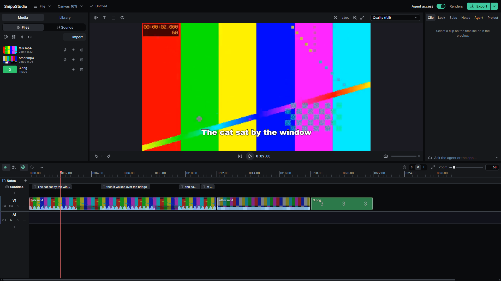

# SnippStudio

[Türkçe](README.tr.md)

A video editor for Windows that runs entirely on your own computer, made to
work with an AI agent you already use. You put your footage on the timeline,
say what you want, the agent does it as a draft, and you watch only what
changed before you accept it.

No account, no cloud, no telemetry. Editing, subtitles, effects and export all
happen locally; the app itself never goes online.

Windows · GPL-3.0-or-later · *SnippStudio is a working title.*



## What it does

- **Timeline.** Ripple trimming, split, slip and cutter tools, linked picture
  and sound, compound clips, adjustment layers, markers, in / out points and a
  loop range, keyframes.
- **Transitions and effects.** Dissolve, slide, wipe, zoom, speed ramps, light
  leaks; colour, LUT files, masks, motion tracking, blur, keying, scopes.
- **Text and shapes**, with per-character entrances and keyframed motion.
- **Subtitles** made on this computer by a Whisper speech model (Turkish,
  English and the other Whisper languages), with word timings, word-by-word
  animations and SRT import / export.
- **Editing by text.** The transcript is the video as a document: delete a
  phrase to cut it from picture, sound and subtitles at once. Silence and
  filler cutting.
- **Fit to voice.** Select pictures in the Media panel and lay them on the
  voice-over in one step, on a new layer: by the number in each file name
  (picture 3 on subtitle line 3), evenly, or into a selected range.
- **Audio.** Volume and fades, EQ, compressor, voice cleaning, ducking under
  speech, loudness normalisation.
- **Templates.** Thirty-one graphics built in code (lists, charts, maps, a
  chess board, a video player…); every word, number and colour stays editable.
- **Code clips.** A folder with an `index.html` goes on the timeline like any
  clip and is drawn from its code, frame-exact in the preview and the export,
  with no render in between. The page runs without network access.
- **Work notes.** Mark a moment or a stretch, draw on the picture, write what
  you want; the agent answers the notes and you approve.
- **Export.** MP4 (H.264) or WebM (VP9) up to 4K, sound only (MP3, M4A, WAV),
  Shorts segments; the preview and the export run the same drawing code.

The full user guide is in [`docs/guide.md`](docs/guide.md)
([Türkçe](docs/kullanim.md)).

## Working with an agent

Turn on **Agent access** in the top bar. SnippStudio runs a
small MCP server on `127.0.0.1` only, with a token; the agent gets a handful of
tools (`project`, `transcript`, `frames`, `changes`, `analyze`, `edit`,
`notes`, `job`, `code_clip`). Its edits gather in one draft you can preview,
accept in part or reject; "back to before the agent" is one undo step.
Claude Code (or Codex) is added once in **Settings → Agent connection**, which
copies the command; from then on every Claude Code chat has the tools while
SnippStudio is open. The agent works from its own chat: SnippStudio has no
terminal of its own and never starts an agent.

| Agent | State |
|---|---|
| Claude Code | tested |
| Codex | experimental, unverified |
| OpenCode | experimental, unverified (you start it with the settings SnippStudio gives you) |
| Antigravity | experimental, never tried with a real install |

The agent is your own program with your own account: SnippStudio never reads,
keeps or types its keys, and makes no AI calls of its own. It does not tell the
agent how to draw an animation either; it plays whatever page the agent
writes. What goes to the agent and what does not:
[`docs/agents.md`](docs/agents.md).

## Install

Download the installer (`SnippStudio Setup <version>.exe`) or the zipped
folder from the Releases page and check it against `SHA256SUMS.txt`.

- **The installer is not code-signed**, so Windows SmartScreen warns before
  it runs (**More info → Run anyway**).
- The speech model (about 0.94 GB) ships inside the package; nothing is
  downloaded on first launch, and there are no automatic updates.
- Windows 10 or 11, 64-bit; 8 GB of memory (16 GB for 4K); about 1.5 GB of
  disk.

## Building from source

Requires [Node.js](https://nodejs.org) 22.12 or newer (Electron 43's own
requirement) on Windows.

```bash
npm ci           # the exact dependency versions of package-lock.json
npm run build    # the app into out/
npm test         # unit tests (Node's own test runner)
npm run dev      # run it with hot reload
```

`npm run dist:dir` makes the unpacked program and `npm run dist` the unsigned
NSIS installer (both into `release/`). Electron fetches its own program the
first time it starts (`npm run dev`, or the end-to-end tests:
`npm run e2e -- --only=<regex>`), from its cache when it is there.

### The speech model

The model is not in the repository (its weights are about 0.94 GB). Without it
everything works except **Generate subtitles**, and the app says the model is
missing. To get it, run once on the build machine:

```powershell
powershell -ExecutionPolicy Bypass -File scripts/download-whisper-medium-multilingual.ps1
```

It fetches the seven files of the multilingual Whisper Medium set from a pinned
revision of
[`onnx-community/whisper-medium_timestamped`](https://huggingface.co/onnx-community/whisper-medium_timestamped)
into `models/` and checks each one's SHA-256. `npm run dist` copies them into
the package ([`models-dist/README.md`](models-dist/README.md)). The packaged
app never downloads anything.

Tests that need the model or the private test footage are skipped with a
reason when those are not there; they do not fail.

### Layout

```
src/main        Electron main process: files, the media:// protocol, the model
                store, the agent server. Every OS capability the app has is here.
src/preload     The only bridge the window gets to the main process.
src/renderer    The editor: timeline, preview, inspector, playback, export.
src/test        Unit tests.
scripts/        Build, package, end-to-end and release scripts.
docs/           The user and agent guides, in English and Turkish.
```

Contributing: [`CONTRIBUTING.md`](CONTRIBUTING.md). Security:
[`SECURITY.md`](SECURITY.md).

## Support

<!-- To be filled in by the maintainer: a donation link, or where to get a
     paid, signed build. Until then this section stays empty. -->

## License

[GPL-3.0-or-later](LICENSE). Copyright (C) 2026 SnippStudio contributors.
Third-party components and their licences are listed in
[`THIRD-PARTY-NOTICES.md`](THIRD-PARTY-NOTICES.md).
