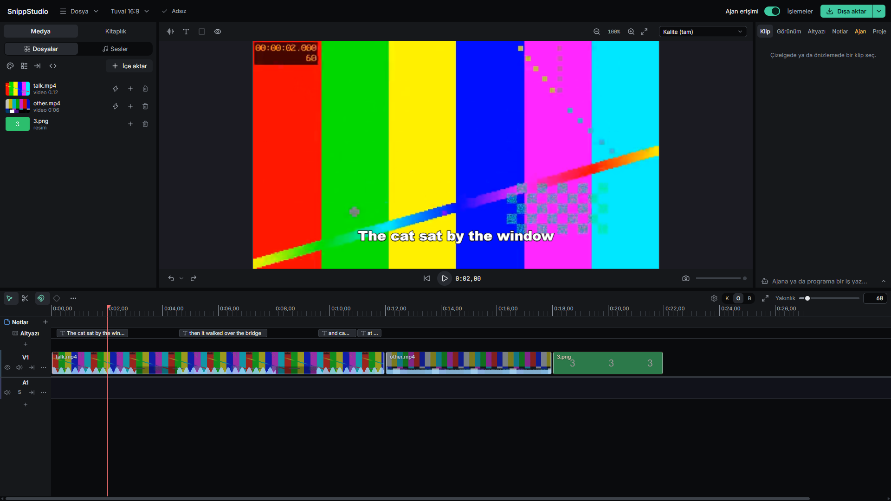

# SnippStudio

[English](README.md)

Windows için, bütünüyle kendi bilgisayarınızda çalışan ve zaten kullandığınız
bir yapay zekâ ajanıyla birlikte çalışmak üzere yapılmış bir video editörü.
Görüntülerinizi çizelgeye koyarsınız, ne istediğinizi yazarsınız, ajan işi
taslak olarak yapar; kabul etmeden önce yalnız değişeni izlersiniz.

Hesap yok, bulut yok, kullanım verisi toplama yok. Kurgu, altyazı, efektler ve
dışa aktarma bilgisayarınızda yapılır; uygulamanın kendisi internete hiç
çıkmaz.

Windows · GPL-3.0-or-later · *SnippStudio bir çalışma adıdır.*



## Neler yapar

- **Çizelge.** Kaydırarak kırpma, bölme, kaydırma (slip) ve kesici araçları,
  bağlı görüntü ve ses, bileşik klipler, ayar katmanları, işaretçiler,
  giriş / çıkış noktaları ve döngü aralığı, anahtar kareler.
- **Geçişler ve efektler.** Çözülme, kaydırma, silme, yakınlaştırma, hız
  rampaları, ışık sızması; renk, LUT dosyaları, maskeler, hareket takibi,
  bulanıklık, renk anahtarı, skoplar.
- **Yazı ve şekiller**, harf harf girişler ve anahtar kareli hareketle.
- **Altyazı**, bu bilgisayarda bir Whisper konuşma modeliyle (Türkçe, İngilizce
  ve öbür Whisper dilleri): kelime zamanları, kelime kelime animasyonlar, SRT
  içe ve dışa aktarma.
- **Metinle kurgu.** Döküm, videonun belge hâlidir: bir sözü silmek onu
  görüntüden, sesten ve altyazıdan birlikte keser. Sessizlik ve dolgu sesi
  kesme.
- **Sese diz.** Medya panelinde seçtiğin görselleri tek adımda, yeni bir
  katmanda seslendirmenin üstüne dizer: dosya adındaki sayıya göre (3 numaralı
  görsel 3. altyazı satırına), eşit aralıkla ya da seçili aralığa.
- **Ses.** Ses düzeyi ve geçişler, EQ, kompresör, ses temizleme, konuşmanın
  altında müziği kısma, ses yüksekliği eşitleme.
- **Şablonlar.** Kodla yapılmış otuz bir grafik (listeler, grafikler, haritalar,
  satranç tahtası, video oynatıcı…); her kelime, sayı ve renk düzenlenebilir
  kalır.
- **Kod klipleri.** İçinde `index.html` olan bir klasör çizelgeye her klip gibi
  girer ve kendi kodundan çizilir; önizlemede ve dışa aktarmada kare kare aynı,
  arada render yok. Sayfa ağa erişmeden çalışır.
- **İş notları.** Bir anı ya da bir aralığı işaretleyin, görüntünün üstüne
  çizin, ne istediğinizi yazın; ajan notları cevaplar, siz onaylarsınız.
- **Dışa aktarma.** 4K'ya kadar MP4 (H.264) ya da WebM (VP9), yalnız ses (MP3,
  M4A, WAV), Shorts bölümleri; önizleme ile dışa aktarma aynı çizim kodunu
  çalıştırır.

Kullanım kılavuzunun tamamı [`docs/kullanim.md`](docs/kullanim.md)
([English](docs/guide.md)).

## Ajanla çalışmak

Üst çubukta **Ajan erişimi**'ni açın. SnippStudio yalnız
`127.0.0.1` üzerinde, anahtarla korunan küçük bir MCP sunucusu açar; ajan
birkaç araç alır (`project`, `transcript`, `frames`, `changes`, `analyze`,
`edit`, `notes`, `job`, `code_clip`). Düzenlemeleri tek bir taslakta toplanır:
önizlenir, bir kısmı kabul edilir ya da reddedilir; "ajandan önceki hâle dön"
tek geri alma adımıdır. Claude Code (ya da Codex) bir kez eklenir (**Ayarlar →
Ajan bağlantısı** komutu kopyalar); sonra her Claude Code sohbeti, SnippStudio
açıkken araçları görür. Ajan kendi sohbetinden çalışır: SnippStudio'nun kendi
terminali yoktur, hiçbir ajanı kendisi başlatmaz.

| Ajan | Durum |
|---|---|
| Claude Code | sınandı |
| Codex | deneysel, doğrulanmadı |
| OpenCode | deneysel, doğrulanmadı (SnippStudio'nun verdiği ayarlarla siz başlatırsınız) |
| Antigravity | deneysel, gerçek bir kurulumla hiç denenmedi |

Ajan sizin programınızdır, sizin hesabınızla çalışır: SnippStudio onun
anahtarlarını okumaz, saklamaz, yazmaz ve kendi başına hiçbir yapay zekâ
çağrısı yapmaz. Ajana bir animasyonu nasıl çizeceğini de söylemez; ajanın
yazdığı sayfayı oynatır. Ajana ne gider, ne gitmez:
[`docs/ajanlar.md`](docs/ajanlar.md).

## Kurulum

Sürümler sayfasından kurulumu (`SnippStudio Setup <sürüm>.exe`) ya da zip'lenmiş
klasörü indirin ve `SHA256SUMS.txt` ile karşılaştırın.

- **Kurulum kod imzalı değildir**; Windows SmartScreen çalıştırmadan önce uyarır
  (**Ek bilgi → Yine de çalıştır**).
- Konuşma modeli (yaklaşık 0,94 GB) paketin içindedir; ilk açılışta hiçbir şey
  indirilmez, otomatik güncelleme yoktur.
- Windows 10 ya da 11, 64 bit; 8 GB bellek (4K için 16 GB); yaklaşık 1,5 GB disk.

## Kaynaktan derleme

Windows'ta [Node.js](https://nodejs.org) 22.12 ya da yenisi gerekir
(Electron 43'ün kendi şartı).

```bash
npm ci           # package-lock.json'daki bağımlılık sürümleri
npm run build    # uygulama out/ klasörüne
npm test         # birim testleri (Node'un kendi test koşucusu)
npm run dev      # anında yenilemeyle çalıştırma
```

`npm run dist:dir` paketlenmiş klasörü, `npm run dist` imzasız NSIS kurulumunu
üretir (ikisi de `release/` içine). Electron kendi programını ilk açılışta
getirir (`npm run dev` ya da uçtan uca denemeler:
`npm run e2e -- --only=<regex>`); önbellekte varsa oradan alır.

### Konuşma modeli

Model depoda değildir (ağırlıkları yaklaşık 0,94 GB). Model yokken **Altyazı
üret** dışında her şey çalışır ve uygulama modelin eksik olduğunu söyler.
Edinmek için derleme yapılan bilgisayarda bir kez şunu çalıştırın:

```powershell
powershell -ExecutionPolicy Bypass -File scripts/download-whisper-medium-multilingual.ps1
```

Betik çok dilli Whisper Medium takımının yedi dosyasını
[`onnx-community/whisper-medium_timestamped`](https://huggingface.co/onnx-community/whisper-medium_timestamped)
deposunun sabitlenmiş bir sürümünden `models/` klasörüne indirir ve her birinin
SHA-256 özetini denetler. `npm run dist` onları pakete kopyalar
([`models-dist/README.md`](models-dist/README.md)). Paketlenmiş uygulama hiçbir
şey indirmez.

Modeli ya da özel test görüntülerini isteyen testler, bunlar yoksa nedeni
yazılarak atlanır; kırılmaz.

### Klasörler

```
src/main        Electron ana süreci: dosyalar, media:// protokolü, model deposu,
                ajan sunucusu. Uygulamanın işletim sistemine dokunan her işi burada.
src/preload     Pencerenin ana sürece giden tek köprüsü.
src/renderer    Editör: çizelge, önizleme, Inspector, oynatma, dışa aktarma.
src/test        Birim testleri.
scripts/        Derleme, paketleme, uçtan uca deneme ve yayın betikleri.
docs/           Kullanım ve ajan kılavuzları, İngilizce ve Türkçe.
```

Katkı: [`CONTRIBUTING.md`](CONTRIBUTING.md). Güvenlik: [`SECURITY.md`](SECURITY.md).

## Destek

<!-- Sürdüren kişi dolduracak: bağış bağlantısı ya da ücretli, imzalı derlemenin
     nereden alınacağı. O zamana kadar bu bölüm boş kalır. -->

## Lisans

[GPL-3.0-or-later](LICENSE). Copyright (C) 2026 SnippStudio contributors.
Üçüncü taraf bileşenler ve lisansları
[`THIRD-PARTY-NOTICES.md`](THIRD-PARTY-NOTICES.md) dosyasında.
